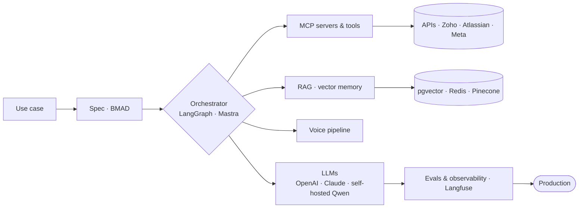

  
  
  

 

## 👋 About me

I'm an **AI Engineer & Backend Developer** who takes AI out of the notebook and into production: autonomous agents, multi-agent systems, MCP servers, RAG and real-time voice agents.

I cover the whole path, from the use case and the spec to orchestration, tools and infrastructure, with **Python**, **Node.js / NestJS** and **Go**.

## 🚀 What I'm building

<table>
<tr>
<td width="50%" valign="top">

### 🧠 Company brain · Facephi
Digital identity & fraud prevention · clients in 30+ countries

- Internal AI platform that puts agents and use cases at the service of every team
- Agents that resolve customer tickets on their own, integrated with **Zoho** and **Atlassian**
- **Self-hosted LLMs (Qwen)** on company servers, provisioned with **Terraform**, alongside OpenAI and Claude
- **MCP servers**, tools and multi-agent RAG flows on **Mastra + Bun** and **LangGraph**
- Spec-driven development with **BMAD**

</td>
<td width="50%" valign="top">

### 🏢 AI for smart buildings · Keedian
Building management for multi-site operators · 12,000+ monitored sites

- Brought AI into a platform serving JCPenney, 7-Eleven, Crate & Barrel and Banco Santander
- Agents that automate **~90% of support processes**
- Autonomous agents + RAG that detect energy anomalies and trigger alerts, calls and technician dispatch
- Low-latency **voice agents** with Twilio, ElevenLabs and Deepgram
- Orchestration with **LangGraph** on NestJS and Redis

</td>
</tr>
</table>

## 🧩 How I build agents

## 🛠️ Tech stack

<table>
<tr>
<td valign="top" width="50%">

**🤖 Agents & orchestration**

**🧠 Models**

**🎙️ Voice agents**

</td>
<td valign="top" width="50%">

**⚙️ Backend**

**🗄️ Data & vector memory**

**☁️ Infrastructure & quality**

</td>
</tr>
</table>

## 📊 GitHub activity

  

<b>🇪🇸 Versión en español</b>

 

Soy **AI Engineer y Backend Developer**. Llevo la IA a producción: agentes autónomos, sistemas multiagente, servidores MCP, RAG y voice agents en tiempo real.

- **Facephi:** construyo el company brain, la plataforma interna de IA de una compañía de identidad digital con clientes en más de 30 países. Agentes que atienden tickets (Zoho, Atlassian), modelos locales (Qwen) en servidores propios con Terraform, servidores MCP y flujos multiagente con Mastra y LangGraph, con metodología spec-driven (BMAD).
- **Keedian:** introduje la IA en una plataforma de gestión de edificios con más de 12.000 sitios monitoreados. Agentes que automatizan cerca del 90 % de los procesos de soporte, detección de anomalías energéticas con despacho de técnicos y voice agents de baja latencia.

Trabajo en remoto desde Argentina (UTC-3). Escribime a **luisgoytia.dev@gmail.com** o por [LinkedIn](https://www.linkedin.com/in/luis-goytia/).

